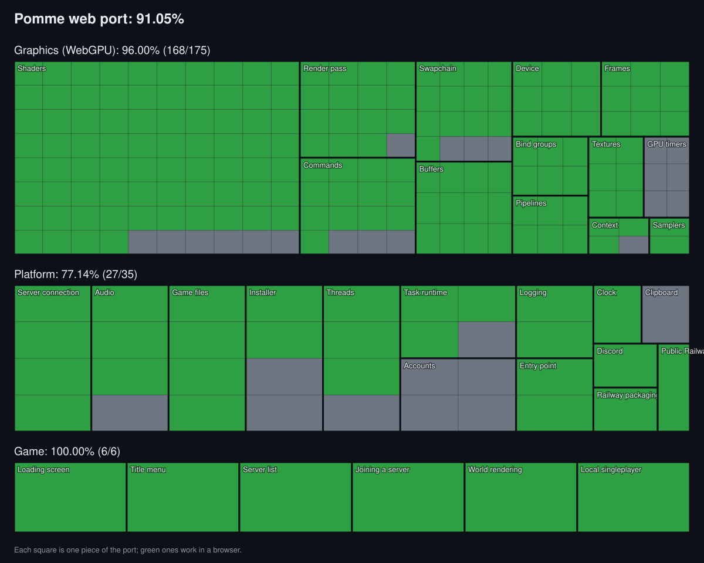
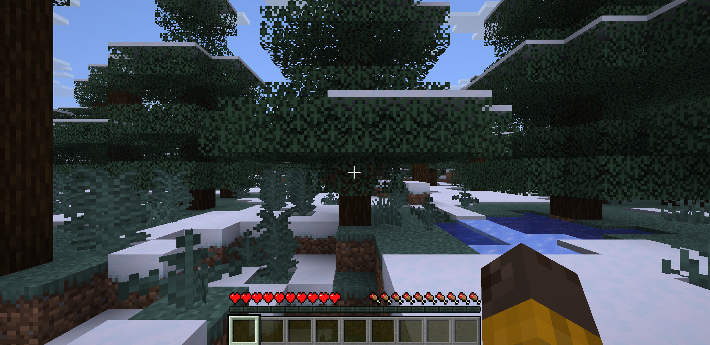
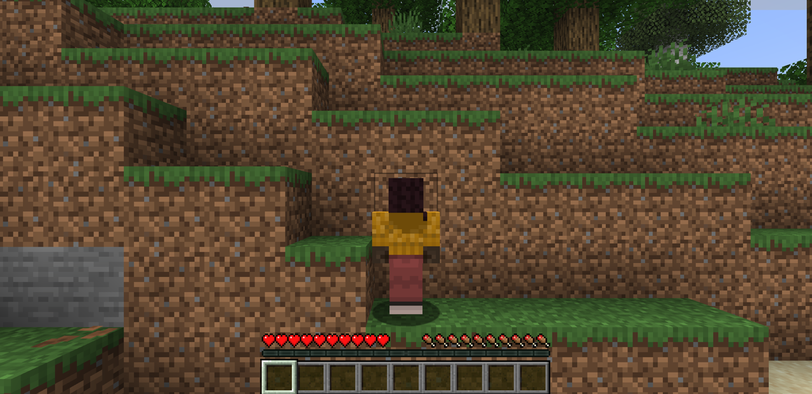
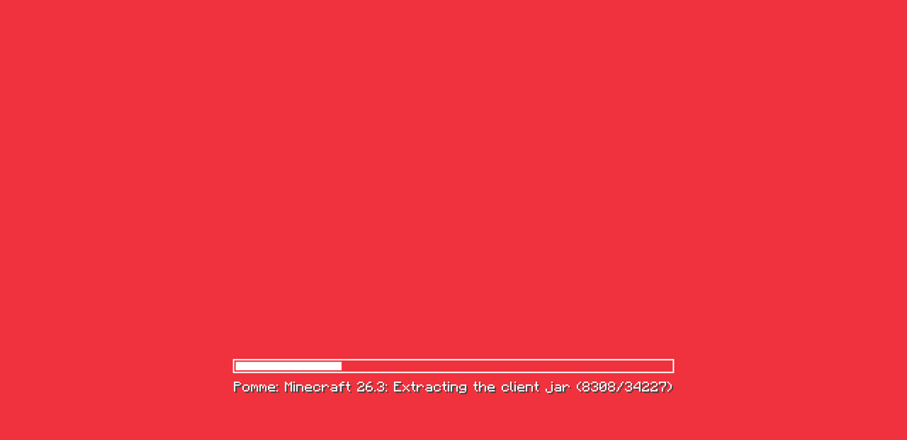
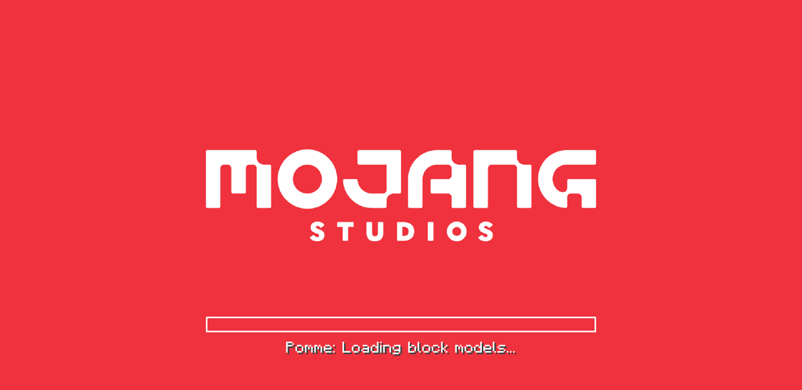
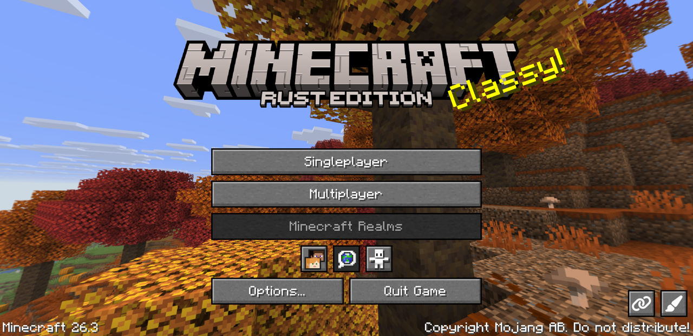
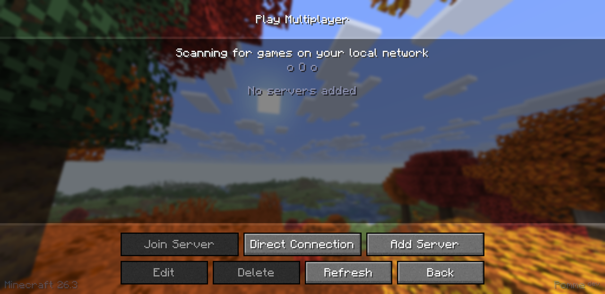
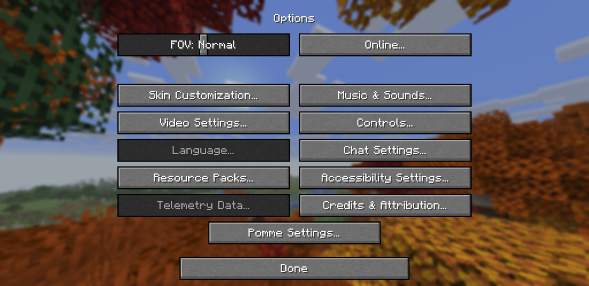
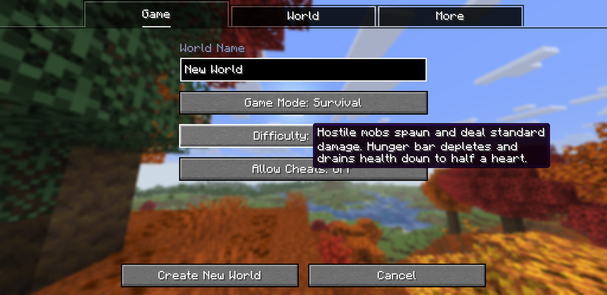

<div align="center">

# PommeWeb

**[Pomme](https://github.com/PommeMC/Client), the Rust Minecraft client, running in your browser.**


</div>

<br>



> [!NOTE]
> **It plays in the browser.** Pomme's own renderer draws the menus and the
> world in Chrome through WebGPU, and joins servers through `pomme-relay`.
> Local singleplayer uses the same integrated SteelMC server as desktop.
> Microsoft sign-in and distant terrain are still in progress.

## Screenshots

<table>
<tr>
<td colspan="2"></td>
</tr>
<tr>
<td colspan="2"></td>
</tr>
<tr>
<td></td>
<td></td>
</tr>
<tr>
<td colspan="2"></td>
</tr>
<tr>
<td></td>
<td></td>
</tr>
<tr>
<td colspan="2"></td>
</tr>
</table>

## Roadmap

- [x] Shaders converted to WGSL at build time — all 74 accepted by Chrome
- [x] Server connections through `pomme-relay` over WebSocket
- [x] Web Audio playback
- [x] Browser task runtime and console logging
- [x] WebGPU graphics backend
- [x] Browser entry point and game files loaded over the network
- [x] **Milestone 1:** loading screen and title menu
- [x] Server list and joining a server
- [x] **Milestone 2:** world rendering and gameplay
- [x] Local singleplayer via the loopback relay
- [ ] Distant terrain
- [ ] Microsoft account sign-in

## How it works

Almost all of the game — menus, world rendering, protocol, physics — is
Pomme's own Rust, compiled to WebAssembly unchanged. Only the places where the
game touches the operating system get a browser version:

| The game needs | On desktop | In the browser |
|---|---|---|
| 🎨 Graphics | Vulkan | WebGPU |
| ✨ Shaders | SPIR-V | WGSL, converted at build time |
| 🌐 Server connections | TCP sockets | WebSocket to `pomme-relay`, which dials the server |
| 🔊 Sound | OpenAL | Web Audio |
| ⚙️ Background tasks | Tokio | the page's event loop |
| 📦 Game files | disk | IndexedDB |
| 📝 Logs | log file | browser console |

## What's in this repo

This repo holds only the web code; it builds against a Pomme checkout.

| Path | Contents |
|---|---|
| [`web/`](web) | JavaScript the page runs — [`webgpu.mjs`](web/webgpu.mjs) (graphics), [`transport.mjs`](web/transport.mjs) (server connections), [`audio.mjs`](web/audio.mjs) (sound), [`asset-storage.mjs`](web/asset-storage.mjs) (game files) — and the page, [`index.html`](web/index.html) |
| [`rust/`](rust) | New browser-only Rust files, at the paths they take in Pomme |
| [`patches/pomme.patch`](patches/pomme.patch) | The port's edits to Pomme's own files, against the commit in [`patches/BASE`](patches/BASE) |
| [`docs/`](docs) | The progress map and its data |

## Play

**One command:** `./play.sh --build` rebuilds the page, starts the loopback
relay with integrated SteelMC support, and opens Chrome. Use **Singleplayer**
to create a world or choose **Play Selected World**. Later launches only need
`./play.sh`. World data lives under `.server/worlds`; the browser keeps the
world list for its current origin. Singleplayer requires the local relay and
is not offered as a publicly hosted service. Continuing the port? Start with
[HANDOFF.md](HANDOFF.md).

By hand:

1. Build it and start the relay (below), then open **http://127.0.0.1:8460**
   in Chrome or Edge.
2. The first visit downloads the game files from Mojang (about 50 MB) behind
   the loading screen; later visits start in seconds.
3. **Multiplayer → Direct Connection**, enter the server's address, **Join
   Server**. You play as `Player` for now, so the server must be in offline
   mode (`online-mode=false`) until Microsoft sign-in comes to the browser.
4. To play on a server on your own machine, start the relay with
   `--allow-private-servers`.

## Build and run

You need a Pomme checkout at the commit in `patches/BASE`, the pinned Rust
nightly with the `wasm32-unknown-unknown` target, and `wasm-bindgen` 0.2.121:

```sh
cargo install wasm-bindgen-cli --version 0.2.121
```

Then:

```sh
cp -R rust/. /path/to/pomme/
git -C /path/to/pomme apply "$PWD/patches/pomme.patch"
POMME_REPO=/path/to/pomme ./build.sh
cd /path/to/pomme && cargo run -p pomme-relay --release -- \
  --dir /path/to/PommeWeb/dist --listen 127.0.0.1:8460 --allow-private-servers
```

and open **http://127.0.0.1:8460** in a browser with WebGPU (Chrome or Edge).
For local singleplayer, build the relay with `--features local-worlds` and
pass `--local-worlds /path/to/world-saves` after Cargo's `--`. Neither
`--public-host` nor `--trust-proxy` can be combined with this option.

<details>
<summary>Working on the port</summary>

- `sync.sh` copies the Rust side back out of a working Pomme checkout.
- `python3 docs/progress.py` redraws the progress map from
  [`docs/progress.json`](docs/progress.json).

</details>

## Railway

Deploy this repository as a Dockerfile service. Railway supplies the public
domain and port; the container serves the built browser client and relay.
The hosted relay only connects to public game servers. Local singleplayer
continues to use `./play.sh` on your own machine.

## License

GPL-3.0-or-later, as Pomme is. See [LICENSE](LICENSE).
